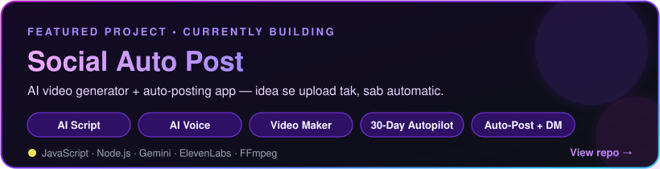

<!-- ✨ NISHU's GitHub profile ✨ -->

---

### 👋 Kaun hoon main?

**Nirbhay Sharma** — par sab mujhe **NISHU** bulaate hain. AI content creator & builder from 🇮🇳 India.
Main AI se videos banata hoon, aur unhe automate karne ke tools bhi khud likhta hoon. Idea se upload tak — sab ek flow me. ⚡

- 🎬 **AI videos** — faceless shorts, AI visuals, AI voiceovers
- 👻 **Hindi horror shorts** — raat ko akele mat dekhna 😶‍🌫️
- 🐱 **Cartoon series** — funny characters, har episode me naya scene
- 🤖 **Automation tools** — script → voice → video → auto-post, bina haath lagaye
- 🚀 **Currently building:** [**Social Auto Post**](https://github.com/shanir01/Social-Auto-Post) — AI video generator + auto-posting app

---

### 🛠️ Tech & Tools

---

### 📌 Featured Project

**Social Auto Post** — ek click → poore mahine ka content: script, AI voice, scenes, captions, video → daily auto-upload. 🗓️✨

---

### 📊 GitHub Stats

---

### 🤝 Connect with me

---

### 💭 *"Sapne bade rakho, aur unhe automate kar do."* 🤖✨

Made with 💜 by NISHU — subscribe karna mat bhoolna 😉

